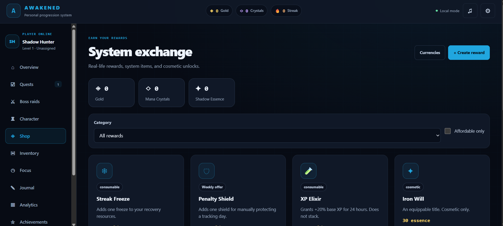
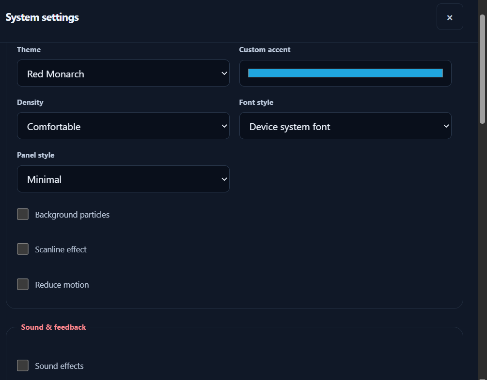

# ⚔️ Habit-Leveling

### Level up your real life.

Turn your daily habits into an RPG-style progression system. Complete quests, earn XP, build streaks, battle bosses, and develop better habits — one level at a time.

**Your real life is the game. Your habits are the quests.**

---

## 📸 Screenshots


<p align="center">
  
</p>

<p align="center">
  
  
</p>

<p align="center">
  
  
</p>

<p align="center">
  
  
</p>

<p align="center">
  
</p>

<p align="center">
  
</p>

---

## ✨ Features

Habit-Leveling combines habit tracking, personal productivity, and RPG-inspired progression to make self-improvement more engaging.

### 🎯 Quests & Habit Tracking
- Create and manage recurring habits, tasks, and personal goals.
- Track checkbox, counter-based, timed, and avoidance quests.
- Configure schedules, deadlines, difficulty, and preferred time blocks.
- Organize quests using priorities, filters, and templates.
- Track completion and review daily progress.

### ⚡ Character Progression
- Earn XP and level up by completing quests.
- Progress through RPG-inspired ranks, from E to S and beyond.
- Develop nine character attributes: STR, INT, AGI, WIL, VIT, CHA, CRE, DIS, and LCK.
- Earn in-game currencies and progression rewards.
- Track milestones and character statistics.

### 🔥 Streaks & Consistency
- Track current and best streaks.
- Evaluate scheduled habits and missed days.
- Support rest days and recovery mechanics.
- Use available protection mechanics to help preserve progress.
- Review consistency across historical periods.

### 🐉 Boss Raids
- Create personal boss encounters around challenging goals.
- Configure boss difficulty, health, deadlines, and attack tasks.
- Deal damage by completing raid objectives.
- Earn progression rewards for successful encounters.
- Handle failures through supported recovery and escape mechanics.

### ⏱️ Focus Timer
- Use Pomodoro-style 25/5 and 50/10 presets.
- Configure custom focus and break durations.
- Link focus sessions to timed quests.
- Track elapsed time and reconcile sessions after interruptions.
- Enjoy optional ambient audio and sound effects.

### 🛒 Shop & Inventory
- Earn and manage in-game currencies.
- Purchase available progression items and consumables.
- Use supported rewards and XP boosts.
- Manage collected items and recovery-related resources.

### 📊 Analytics & Activity
- Review XP, streaks, focus time, and quest completion.
- Explore historical progress over different time ranges.
- View consistency and activity summaries.
- Export supported analytics data to CSV.
- Maintain a journal and review recent activity.

### 🏆 Achievements & Challenges
- Track milestones and achievements.
- Participate in supported challenges and weekly gates.
- Connect personal progress to the game's reward systems.

### 💾 Local Data & Recovery
- Persist application state in browser storage.
- Validate and normalize saved data.
- Handle storage errors and conflicting writes.
- Provide recovery-oriented handling for certain startup failures.

### 🎨 Immersive Interface
- Dark, game-inspired visual design.
- Interactive feedback and progression effects.
- Sound controls and ambient audio.
- Dedicated sections for quests, character progression, raids, focus, inventory, and analytics.

---

## 🎮 How It Works

1. **Create your quests** — Choose the habits and goals you want to develop.
2. **Complete daily objectives** — Record your progress as you go.
3. **Earn experience** — Build XP, streaks, and character attributes.
4. **Challenge yourself** — Take on boss raids and focused work sessions.
5. **Review your progress** — Use analytics to understand your consistency.
6. **Keep leveling up** — Turn small daily actions into lasting improvements.

The goal isn't to play a game instead of improving your life. It's to make the process of improving your life feel rewarding.

---

## 🛠️ Built With

- **HTML5** — Application structure
- **CSS3** — Styling, layouts, and visual effects
- **JavaScript (ES modules)** — Application logic and modular systems
- **Browser Storage APIs** — Local persistence

Habit-Leveling is built as a browser-based application with a modular JavaScript architecture.

---

## 🚀 Getting Started

### Prerequisites

- A modern web browser
- Git
- A local development server, such as the VS Code Live Server extension

### Installation

**1. Clone the repository**

```bash
git clone https://github.com/TheFool-27/Habit-Leveling.git
```

**2. Enter the project directory**

```bash
cd Habit-Leveling
```

**3. Start a local server**

Open the project in VS Code and use the Live Server extension, or use another local static server.

**4. Open the application**

Visit the local URL provided by your development server.

> A local server is recommended because browser security restrictions can affect JavaScript ES module loading when opening HTML files directly.

---

## 🏗️ Project Structure

```text
Habit-Leveling/
├── assets/             # Screenshots and visual assets
├── modules/            # Modular application systems
├── index.html          # Application entry point
├── script.js           # Application bootstrap and coordination
├── style.css           # Application styling
├── manifest.json       # Web application metadata
├── LICENSE             # MIT License
└── README.md           # Project documentation
```

The `modules/` directory separates responsibilities such as state management, quest handling, progression, streaks, raids, focus sessions, analytics, and UI behavior.

---

## 🔒 Data & Privacy

Habit-Leveling uses browser-local persistence for application state.

- Progress is stored locally in the browser rather than requiring a user account.
- Clearing browser storage can remove locally saved progress.
- Browser-local storage does not automatically synchronize data between devices.
- Local storage is not an encrypted vault.

Back up important progress whenever an appropriate export or recovery option is available.

---

## 🗺️ Roadmap

Potential areas for continued improvement:

- [ ] Expand automated tests for progression, scheduling, and persistence.
- [ ] Improve onboarding and first-time user guidance.
- [ ] Polish mobile layouts and quick habit entry.
- [ ] Strengthen backup and recovery workflows.
- [ ] Improve accessibility and keyboard navigation.
- [ ] Refine performance and reliability across browsers.
- [ ] Improve documentation and release workflows.

---

## 🤝 Contributing

Suggestions, bug reports, and contributions are welcome.

1. Fork the repository.
2. Create a feature branch.
3. Make your changes.
4. Test your changes locally.
5. Open a pull request describing the changes.

For larger changes, open an issue first to discuss the proposal.

---

## 🐛 Issues & Feedback

Found a bug or have an idea?

[Open an issue on GitHub](https://github.com/TheFool-27/Habit-Leveling/issues).

---

## 📜 License

This project is licensed under the [MIT License](LICENSE).

---

<p align="center">
  <strong>Build better habits. Complete your quests. Level up your life.</strong>
</p>

<p align="center">
  If you like the project, consider giving the repository a ⭐
</p>
